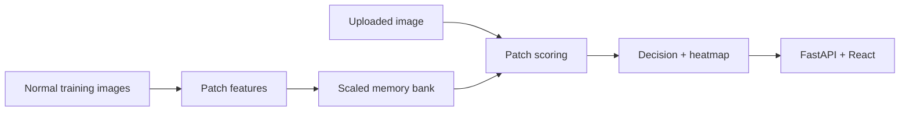

# VisionGuard AI

VisionGuard AI is a portfolio-grade visual inspection service that learns only from **normal**
surface images. It scores unfamiliar image patches, localizes suspicious regions as a heatmap,
and exposes the result through FastAPI and a React interface.

> This v0.1 release uses a reproducible synthetic dataset and a lightweight statistical patch
> detector so the complete training-to-serving path runs on a laptop without a GPU. It is an
> engineering reference, not a production quality-control system.

## What is included

- deterministic synthetic surface images with scratch, spot, and crack masks;
- manifest validation that prevents anomalous images entering the training split;
- normal-only patch feature memory and k-nearest-neighbour anomaly distance;
- image-level score, threshold decision, pixel-level heatmap, and offline metrics;
- FastAPI upload API, responsive React UI, Docker Compose, tests, linting, typing, and CI;
- model card, architecture notes, evaluation report, and an honest v0.2 roadmap.

## Architecture



## Quick start on Windows PowerShell

Requirements: Git, Python 3.12, Node.js 22+, and `uv`.

```powershell
# If uv is not installed, select winget explicitly (avoids a failing msstore source)
winget install --id astral-sh.uv -e --source winget

git clone <your-repository-url> visionguard-ai
cd visionguard-ai
uv sync --extra dev

uv run visionguard generate-sample --output data/sample --seed 42
uv run visionguard validate --manifest data/sample/manifest.csv
uv run visionguard train --manifest data/sample/manifest.csv
uv run uvicorn visionguard_ai.api:app --reload --host 127.0.0.1 --port 8000
```

Keep that terminal open. In a second PowerShell window:

```powershell
cd visionguard-ai\apps\web
npm install
npm run dev
```

Open <http://localhost:5173>. API documentation is at <http://127.0.0.1:8000/docs>.

### PowerShell API smoke test

Use an actual generated image so the multipart body is encoded correctly:

```powershell
curl.exe -X POST "http://127.0.0.1:8000/v1/predict" `
  -H "accept: application/json" `
  -F "file=@data/sample/test/anomaly/VG-00083.png;type=image/png"
```

Do not manually build JSON for this endpoint; `/v1/predict` expects `multipart/form-data` with a
field named `file`.

## Docker Compose

```bash
docker compose up --build
```

The UI is available at <http://localhost:5173>, the API at <http://localhost:8000>, and the
OpenAPI page at <http://localhost:8000/docs>. The API image generates the deterministic sample
dataset and trains the small detector during its image build.

## Developer workflow

```bash
uv sync --extra dev
uv run ruff format --check .
uv run ruff check .
uv run mypy src
uv run pytest

cd apps/web
npm install
npm run build
```

Useful CLI commands:

```bash
uv run visionguard generate-sample --output data/sample --seed 42
uv run visionguard validate --manifest data/sample/manifest.csv
uv run visionguard train --manifest data/sample/manifest.csv
uv run visionguard predict data/sample/test/anomaly/VG-00083.png
```

Generated model binaries and per-image prediction files are deliberately ignored. The small
JSON evaluation summary is committed so reviewers can inspect the measured baseline. Re-run
training to reproduce all artifacts.

## Repository map

| Path | Purpose |
|---|---|
| `src/visionguard_ai/` | data contract, feature extraction, detector, service, API, CLI |
| `apps/web/` | React/Vite inspection interface |
| `tests/` | dataset, model, CLI, and HTTP contract tests |
| `data/sample/` | generated synthetic images, masks, and manifest |
| `artifacts/metrics.json` | reproducible evaluation summary |
| `docs/` | architecture, evaluation, model card, and backlog |

## Scope and responsible use

Synthetic performance does not predict factory performance. Real deployment requires calibrated
camera/lighting fixtures, representative normal data, real defect labels, line-specific
thresholds, latency testing, drift monitoring, human override, and a fail-safe policy. See
[`docs/MODEL_CARD.md`](docs/MODEL_CARD.md) and [`docs/BACKLOG.md`](docs/BACKLOG.md).

## License

Code is released under the MIT License. Generated sample images are original synthetic artifacts
created by this repository. External datasets are not redistributed.
