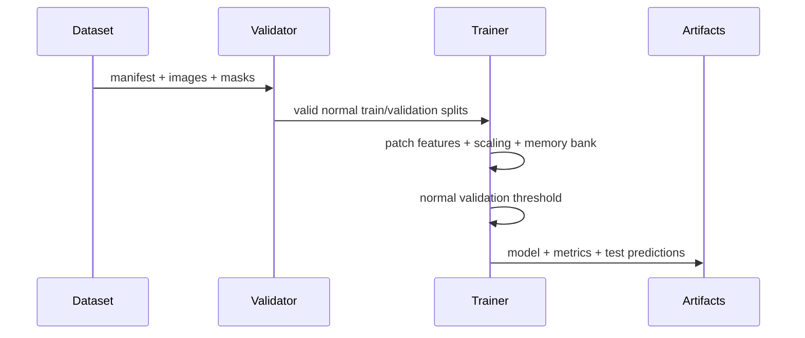

# Architecture

## Design objective

The v0.1 system demonstrates a complete anomaly-detection product path without requiring a GPU
or proprietary inspection data. The boundary between dataset, model, service, and UI is explicit
so a stronger representation model can replace the baseline without changing the API contract.

## Components

1. `sample_data.py` creates deterministic grayscale surfaces and pixel masks for three simulated
   defect families.
2. `data.py` validates the manifest, paths, image/mask dimensions, enums, unique IDs, and the
   normal-only training invariant.
3. `features.py` divides each image into overlapping patches and derives seven local statistics.
4. `model.py` standardizes normal features, keeps a bounded memory bank, scores each patch by
   mean k-nearest-neighbour distance, calibrates on normal validation images, and evaluates on a
   held-out labeled test split.
5. `service.py` owns lazy model loading, image decoding/resizing, inference, and overlay rendering.
6. `api.py` supplies the HTTP boundary. `apps/web` is a separate browser client.

## Training sequence

## Inference contract

`POST /v1/predict` accepts one PNG or JPEG as multipart field `file`, limits the body to 5 MB,
and returns:

- `anomaly_score`: mean of the highest 5% patch distances;
- `threshold`: quantile calibrated from normal validation images;
- `is_anomaly`: strict score comparison against the threshold;
- `model_version`: artifact contract version;
- `heatmap_data_url`: PNG overlay encoded as a data URL.

## Production evolution

The `DetectorBundle` is deliberately isolated behind `VisualInspectionService`. A PatchCore-style
backbone, approximate nearest-neighbour index, object storage artifact registry, and async job
queue can replace the current internals while preserving HTTP semantics. For production, add a
model registry, immutable dataset versions, metrics/trace export, authentication, rate limiting,
and camera-specific preprocessing profiles.
